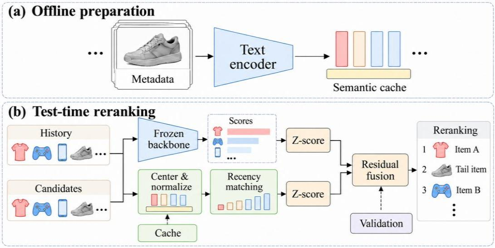

# TSRC：面向长尾序列推荐的测试时语义残差校准

本项目对应论文 **Unlocking LLM Semantics: Test-Time Semantic Residual Calibration for Long-Tail Sequential Recommendation**。

## 模型简介

TSRC 利用离线物品语义，在测试时校准序列推荐模型的得分，为长尾物品和短历史用户补充推荐信号。

- **TSRC 无需额外训练**：先训练 LLM-ESR 骨干，测试时冻结骨干并完成重排。
- **无需在线调用 LLM**：直接使用缓存的物品语义向量。
- **结合近期兴趣**：按交互的新近程度聚合用户兴趣。
- **支持多种骨干**：适用于采用 SASRec、BERT4Rec、GRU4Rec 三种编码器的 LLM-ESR。



语义分支对物品向量中心化、归一化，并计算近期兴趣匹配得分；再与骨干得分分别标准化，通过残差融合重排。融合权重在验证集上确定，测试时固定。

## 数据集获取

- **数据集**：Yelp、Amazon Fashion、Amazon Beauty。
- **下载**：[预处理数据](https://drive.google.com/file/d/1MpBUjCDLiFIEODTnopSCzDAnS8RzO9aV/view?usp=sharing)，由 [LLM-ESR 官方仓库](https://github.com/Applied-Machine-Learning-Lab/LLM-ESR)提供。
- **存放目录**：`data/yelp/handled/`、`data/fashion/handled/`、`data/beauty/handled/`。
- **所需文件**：`inter.txt`、`itm_emb_np.pkl`、`pca64_itm_emb_np.pkl`、`sim_user_100.pkl`。

## 运行环境

参考实验环境如下，依赖版本见 [environment.yml](environment.yml)。

| 项目 | 配置 |
|---|---|
| 操作系统 | Windows x64 |
| CPU / 内存 | AMD Ryzen 7 9800X3D / 16 GB |
| GPU / 驱动 | NVIDIA RTX 5060 Ti 16 GB / 610.62 |
| Python / pip | 3.10.20 / 26.1.2 |
| PyTorch / CUDA 运行时 | 2.11.0+cu128 / 12.8 |
| NumPy / pandas / tqdm | 1.24.3 / 2.0.1 / 4.65.0 |
| TensorBoard | 2.20.0 |

## 论文超参数

以下设置对应论文第 4.3 节和第 4.6 节。选检查点与测试的评测方式可以分别通过命令切换。

| 参数 | 设置 |
|---|---|
| 离线物品语义 | text-embedding-ada-002，1536 维，TSRC 语义缓存冻结 |
| 骨干每个视图的隐藏维度 | 64 |
| 优化器 / 学习率 | Adam / 0.001 |
| 训练批大小 | 128 |
| 最大序列长度 | 200 |
| 最大训练轮数 / 早停耐心值 | 200 / 20 |
| 骨干选模指标 | 验证集 `NDCG@10`，训练阶段关闭 TSRC |
| 近期衰减系数 γ | 0.2 |
| 向量归一化数值下界 δ | 10⁻⁸ |
| 候选得分标准化数值下界 ε | 10⁻⁶，采用总体标准差 |
| 完整 TSRC 融合权重 λ | 0.0 至 3.0，步长 0.1；按验证集 `NDCG@10` 选择，并列时取较小值 |
| 关闭标准化时的 λ 网格 | `{0, 0.001, 0.003, 0.01, 0.03, 0.1, 0.3, 1, 3, 10, 30, 100}` |
| 固定权重消融 | λ=1，其余完整 TSRC 设置保持一致 |
| 采样评测候选集 | 1 个真实目标 + 100 个均匀无放回负例，排除完整输入历史及真实目标 |
| 完整实验随机种子 | 41、42、43、44、45；评测采样种子随运行种子设置 |

长尾分组阈值在同一数据集的全部骨干和消融配置间固定；严格低于阈值者归入尾部。

| 数据集 | 用户历史长度阈值 | 物品交互用户数阈值 |
|---|---:|---:|
| Yelp | 12 | 13 |
| Fashion | 3 | 4 |
| Beauty | 9 | 4 |

## 运行命令

以下命令在**仓库根目录（包含 `main.py` 的目录）**执行。先创建环境，并按上方说明下载、放置所选数据集的四个预处理文件；运行时会从头训练骨干，随后自动完成测试。

### 创建环境

```powershell
conda env create -f environment.yml
conda activate tsrc
```

### 单个组合：Fashion–GRU4Rec，训练后自动测试

```powershell
powershell -NoProfile -ExecutionPolicy Bypass -File .\experiments\run_all_mcrr_experiments.ps1 -Datasets fashion -Models llmesr_gru4rec -SeedsCsv "42" -GpuIdsCsv "0" -NumWorkers 0 -Epochs 200 -CheckpointEvalMode full -EvalMode sampled -ForceRetrain
```

这一条命令会依次执行：

1. 从头训练 Fashion–GRU4Rec 骨干，最多 200 个 epoch，验证指标连续 20 个 epoch 不提升时提前停止；按全物品验证集的 `NDCG@10` 保存最佳检查点。
2. 使用**本次训练生成的最佳检查点**，自动测试 Base、完整 TSRC 及各消融配置，并在验证集上选择 TSRC 融合权重。
3. 保存测试指标、逐用户排名和汇总 CSV。测试采用每位用户 1 个正样本 + 100 个负样本的采样评测协议。

`-ForceRetrain` 保证每次执行都会重新训练，即使本地已有同名检查点，也不会跳过训练。完成环境和数据准备后，复制这一条命令即可运行完整流程。

### 全部组合：3 个数据集 × 3 个骨干 × 5 个随机种子

先准备好 Yelp、Fashion、Beauty 三个数据集，再执行：

```powershell
powershell -NoProfile -ExecutionPolicy Bypass -File .\experiments\run_all_mcrr_experiments.ps1 -SeedsCsv "41,42,43,44,45" -GpuIdsCsv "0" -NumWorkers 0 -Epochs 200 -CheckpointEvalMode full -EvalMode sampled -ForceRetrain
```

该命令依次完成 45 个骨干的从头训练；每个骨干训练结束后，自动执行 Base 和 9 种 TSRC 配置的测试。

### 自行选择评测方式

两个参数互相独立，均支持 `full`（全量）和 `sampled`（采样）：

| 用途 | PowerShell 参数 | `main.py` 参数 | 默认值 |
|---|---|---|---|
| 训练期间验证、挑选骨干检查点 | `-CheckpointEvalMode` | `--checkpoint_eval_mode` | `full` |
| TSRC 验证集选权及最终测试 | `-EvalMode` | `--eval_mode` | `sampled` |

若需要全量测试，将运行命令中的 `-EvalMode sampled` 改为 `-EvalMode full`；若需要按采样验证集挑选检查点，将 `-CheckpointEvalMode full` 改为 `-CheckpointEvalMode sampled`。测试数据始终不参与检查点或融合权重的选择。

### 结果位置

- 本次训练的最佳检查点：`saved_mcrr_base/<dataset>/<model>/base_seed<seed>/pytorch_model.bin`。
- 完整 TSRC 测试指标：`output/mcrr_ablation/<dataset>/<model>/seed<seed>/mcrr_c1r1z1_full.json`。
- 完整 TSRC 逐用户排名：同目录下的 `mcrr_c1r1z1_full.ranks.npz`。
- 全部测试结果汇总：`output/mcrr_ablation/mcrr_ablation_summary.csv`。
- 训练和测试日志：`log/`。

代码基于 [LLM-ESR 官方仓库](https://github.com/Applied-Machine-Learning-Lab/LLM-ESR)，保留原 MIT 许可，见 [LICENSE](LICENSE)。
